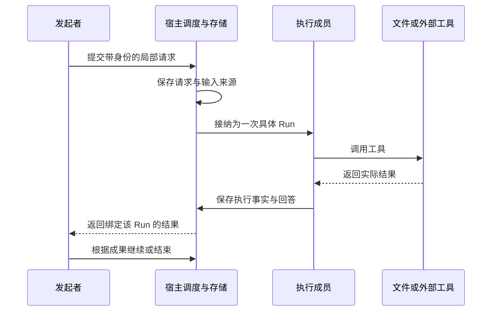

# 多 Agent 协作的架构模型：沿任务、信息与控制权理解框架

> 核查日：2026-09-22。本文是各源码专题的共同阅读地图。比较结论来自对应固定快照；协议和论文注明独立版本。它不是某个框架的使用教程，也不假设读者已经了解相关项目。

## 1. 从一个实际任务理解“协作”

假设我们要给现有桌面应用增加一个导出功能。一个 Agent 可以查后端、改界面、运行必要检查并交付。拆成多个 Agent 后，后端研究、界面实现和独立审查可能同时推进；也可能因为接口没有统一而返工更多。

真正需要设计的是五件事：谁决定目标和分工；每个人收到什么上下文；什么条件触发下一步；怎样处理共同文件与工具；如何确认成果、取消和恢复。角色名称只是这些设计的可见表面。

本轮重点是完整协作框架，包括 Deep Agents、Agent Teams、DeerFlow、AgentScope、Eino、Microsoft Agent Framework 等。多会话消息是其中一项基础能力：它可以承载协作，但不会自动产生计划、依赖调度、子任务生命周期或结果综合。

## 2. 六种常见组织方式，控制权各不相同

| 方式 | 从输入到输出的基本过程 | 谁决定下一步 | 适合的问题 | 主要代价 / 代表 |
| --- | --- | --- | --- | --- |
| Agent as tool / 子任务 | 父级发局部请求，子级完整运行，返回结果 | 父级模型或调用程序 | 大量检索、局部实现、一次审查 | 简报遗漏；Deep Agents、SDK `as_tool` |
| Handoff / 控制权交接 | 当前 Agent 把后续对话交给另一位 | 当前 Agent 的路由决定 | 意图分流、咨询转专家、动态接力 | 历史污染、往返循环；OpenAI SDK、Strands Swarm |
| 确定工作流 / Graph | 输入进入图，满足依赖的节点运行，结果归并 | 代码、条件边、调度器 | 流程稳定、节点接口清楚 | 图维护与状态合并；LangGraph、MAF、Eino、Coze |
| Supervisor / Manager | 中央 Agent 分派、观察、调整，再汇总 | 中央模型和宿主约束 | 任务分解不能事先完全确定 | 中心上下文和调度成本；CrewAI、Devin |
| Teams / 持续成员协作 | 建立成员身份，发任务 / 消息，成员多轮工作 | Lead 与受约束的成员 | 质询、返修、并行实现中的协调 | 邮箱、认领、退出与恢复；Claude、AgentScope、DSH |
| 共享工作区 / Blackboard | 成员读写共同产物，通过变化协调 | 图、成员或外部调度策略 | 多人围绕同一复杂产物渐进工作 | 状态归属和语义冲突；ChatDev 2.0、AgentRoom |

这不是互斥分类。Deep Agents 可以运行在 LangGraph 中，一个 graph 节点也可以是完整 team。选型时需要指出具体使用哪条路径；“支持多 Agent”无法说明这次任务如何运行。

ReAct、self-ask、plan-execute-replan 等又是另一个维度：它们规定推理与行动怎样交替。一个 Agent 就能 plan-execute-replan；一个 team 也可以每位成员都使用 ReAct。Eino 专篇展示了 planner、executor、replanner 的显式组合，但角色数量本身不是推理模式。

## 3. 第一步：定义能力，再创建工作实例

Agent 定义描述角色、模型、工具、Skill 和输入输出形式；实例则拥有本次历史、状态与生命周期。将两者混在一起会出现三个问题：改角色配置影响在途运行；多个实例误用同一历史对象；恢复时无法知道旧结果来自哪一版配置。

Deep Agents 的子类型、Strands 的 preset、TRAE 的 Markdown 定义都在解决能力发现；Dify v2 的 binding + snapshot 更进一步固定一次执行使用的配置。它们不能被简化为“都用一段 system prompt”。[Deep Agents](02-deepagents-langgraph.md) [Strands](15-strands.md) [Dify](14-enterprise-platforms.md)

对本项目，一份 Skill 只是知识和流程资源，不自动成为执行者。需要独立上下文、单独预算或可接续历史时，才创建 worker / 会话。模型已知的工具 schema 和实际获准执行的能力也需分别表达。

## 4. 第二步：建立足够清楚的身份与上下文边界

### 4.1 不同 ID 解决不同歧义

| 身份 | 回答的问题 | 不能替代什么 |
| --- | --- | --- |
| Project / Workspace | 在哪里工作、共享哪些资源 | 操作系统权限边界 |
| User Task / Goal | 用户希望最终完成什么 | 每次模型运行 |
| Session / Thread | 哪份可接续历史 | 一条协作请求或一次执行 |
| Agent / Member | 谁承担可重复分派的工作 | 本次任务是否已完成 |
| Request / Assignment | 具体委派了什么 | 长期成员身份 |
| Run / Attempt | 本次实际执行及结束状态 | 该会话之后的其他回答 |
| Message / Event / Tool Call | 哪条消息、事实、工具副作用 | “角色叫 reviewer”之类展示名称 |

这些概念不要求全部变成新数据表。应复用已有身份，只在真实路由歧义出现时补足。例如用目标会话最后一条回答作为协作结果，就可能拿到用户后来另问的问题；按 assignment 绑定的 Run 收集结果才能消除歧义。DSH 与本项目现有实现都提供相关参考。[Teams](03-agent-teams.md) [本项目](12-project-implications.md)

### 4.2 三种上下文流向

**局部简报。**只传目标、约束、必要事实与来源位置，适合边界清楚的工作。它降低干扰，但要求子任务能主动补读资料。

**历史分叉。**传父级有效历史，再附新的局部目标。它保留隐含约束，也复制不相关信息。需要处理压缩后的历史、未完成工具调用和 provider 原生状态，不能直接复制一个内部对象。

**显式共享状态。**通过字段、共享文件、任务板或知识库传递信息。它不要求广播完整历史，却要求明确更新规则和来源。共享“当前接口版本”与共享“每个人所有推理”是完全不同的设计。

默认广播会使成员数与信息量一起增长。若有 N 个成员各发 M 条消息，全员接收可能接近 N×(N−1)×M 次投递；这是通信模型的量级示意，不是本轮产品性能测量。因此应优先定向发送、需要时共享、按来源回读。

## 5. 第三步：调度、等待与重规划

确定工作流可以用依赖关系计算就绪集合；动态 Supervisor 则由模型决定新的子任务。Deep Agents 的异步任务、DeerFlow 的后台池、Strands Graph 的并行 batch 表明，“异步”还必须说明谁持有执行句柄、队列是否有限、结果如何回来、取消怎样传递。

Plan-execute-replan 的合理闭环是：计划表达可执行片段，执行带回事实，replanner 根据事实决定结束、调整或补充。若 planner 只不断扩充计划，executor 不返回可观察结果，循环就缺少纠正依据。反过来，如果计划中每个条目都被宿主变成强制关卡，也可能阻止合理调整。

等待应由运行事件驱动，避免让模型不断请求“你完成了吗”。状态还应区分工作中、空闲、等待人工、等待工具、等待同伴和真正结束。idle 只说明现在没有工作，不能自动代表成员消失，也不能代表总目标完成。

成员 A 发消息给 B、B 回消息给 A 是正常通信；A 正在等 B 完成、B 又在等 A 完成才可能形成等待环。是否阻止、解除等待或返回状态，应依据实际等待关系，而非简单禁止双向联系。

## 6. 第四步：协作消息与工具副作用是两套承诺

这张图是比较用的数据流，不是要求新建一套事务系统。实际系统的关键问题是箭头之间发生中断怎么办。消息入队只证明宿主保存了它；进入下一次模型输入只证明投递；模型完成一轮也不证明正确处理了消息；收到工具成功结果才为具体副作用提供证据。

因此，队列的 at-least-once、消息去重或 Redis 原子弹出，都不能直接升级为业务 exactly-once。重启后自动重放模型调用，可能导致再次写文件、执行命令或创建远端资源。框架 checkpoint 保存的是运行状态，外部工具是否支持幂等，需要单独判断。

DSH 的邮箱来源关联、Strands 在途回合提交标记、Dify 的 deferred tool results 分别解决不同恢复歧义。它们比泛泛的“支持持久化”更值得借鉴。[DSH](03-agent-teams.md) [Strands](15-strands.md) [Dify](14-enterprise-platforms.md)

## 7. 第五步：共享代码与成果汇合

同目录协作可以直接共享当前代码，适合本项目默认方式；其成本是看到文件随时变化。worktree 提供独立 Git 工作目录和分支，减少直接覆盖；其成本是集成和环境复制。容器 / VM 提供实际执行边界；它不自动解决分支冲突，也不保证业务结论一致。

最常见的三种冲突分别是：同一文本被同时修改；不同模块遵循不同接口；两个成员各自认为对方负责最后一步。第一种可通过现有编辑冲突反馈处理；第二种需要明确决策与共享契约；第三种需要任务归属和汇合责任。不能用一个“独立工作副本”选项解决全部问题。

2026-08-24 的 AgentRoom 论文尝试 CRDT 共享文件系统，配合 claim、状态与广播工具。论文范围有限，部分结论依赖 LLM judge 和特定任务；不能视作大规模生产验证。其启发是文件合并与工作协调要一起设计，CRDT 的收敛不等于代码语义正确。[AgentRoom][agentroom]

本项目已有原目录协作约定，应优先研究范围说明、来源回查与冲突反馈。是否引入 worktree、远程环境或 CRDT，应有具体用户选择或可证明的需求。

## 8. 第六步：结果、评估与可观测性

### 8.1 结束条件应分层

一次模型回答结束、一个 worker 执行结束、一个任务报告完成、整个用户 Goal 满足，是四个不同事实。Agno / CrewAI 等框架里的完成标记可以驱动编排，但不能独立证明修改正确。宿主保存真实工具事实，模型给出 summary / outcome，用户可以据此判断；无需把可选报告字段全部升为结束门槛。

适合本项目的评估比较应至少控制：同一任务、同一模型范围、相近总预算、相同文件初态与工具。比较单 Agent、有界委派、Teams 三组，观察可接受成果、总耗时、token、返工、重复工作和人工干预。所有这些目前是建议，未在本轮执行。

### 8.2 LangSmith 与 Langfuse 都必须看

| 观察问题 | LangSmith 的相关机制 | Langfuse 的相关机制 | 本项目可借鉴处 |
| --- | --- | --- | --- |
| 一次调用跨服务怎样串起来 | 传播 tracing headers，关联跨服务 run | 通过 trace / observation 的关系组织记录 | 显式保存父级、协作请求和目标 Run 关联 |
| 多轮工作怎样比较 | thread / session 级观察与评估入口 | session 组织多个 trace | 不把单轮结果等同长期任务质量 |
| 如何看拓扑与实际执行 | tracing、运行树与图框架集成 | Agent Graph 的聚合 / 展开视图 | 结构视图与本次实际轨迹分开 |
| 如何持续改进 | 数据集、评估与生产 trace 反馈 | 数据集、评估、评分和观测 | 从真实失败抽取小型比较样本 |

LangSmith 当前分布式追踪文档明确提供跨服务上下文传播；Langfuse 的 Agent Graph 可以从 observations 的时间和嵌套推断，也可通过 LangGraph 集成。聚合视图按步骤合并，展开视图显示每次调用。[LangSmith][langsmith] [Langfuse][langfuse] [Langfuse session 实践][langfuse-practice]

需要谨慎的是：推断出的图不等于调度器的权威依赖图；trace 丢失也不代表任务没执行。追踪系统适合观察和评估，恢复仍应依赖本项目已有业务事实存储。LangSmith 的部署运行时与其观测产品也应分开判断能力，不把平台营销中的 exactly-once 泛化到任意外部副作用。

## 9. 跨系统协议：MCP、A2A、ACP 各管什么

### 9.1 MCP：工具与资源连接，版本需要按日期核实

本轮核实到 MCP **2026-07-28** 规范已发布，采用无状态协议核心、Multi Round-Trip Requests、基于 header 的路由、可缓存目录和扩展框架；TypeScript SDK v2 对应这一新规范。因此不能继续将 2025-11-25 当作最新协议，也不能把所有“MCP 2.0”说法当作同一个版本号。[官方发布][mcp-current] [TypeScript SDK v2][mcp-sdk]

长任务在旧版 2025-11-25 以实验性 Tasks 引入，新版路线放入扩展体系。应用仍需核对客户端与服务器实际协商的能力。MCP 传输无状态不代表业务 Agent 无状态，更不意味着消息、记忆和运行可以不保存。

一个 Agent 可以作为 MCP 工具被调用，但工具协议不会自动建立团队负责人、共享任务或代码集成策略。它解决连接边界，框架解决协作行为。

### 9.2 A2A：远程工作单元及其状态和产物

本轮采用官方已发布 **1.0.0** 规范，而非早期 0.3 教程。Task、context、Message、Artifact 和状态更新分别描述工作、相关交互和结果；同一个 context 可以包含多个 task。协议给出发现、通信和生命周期契约，不规定远端 Agent 的内部提示词或工具循环。[A2A 1.0][a2a]

Agent Card 中的 skill 是能力描述，不应直接理解成磁盘 `SKILL.md` 文件。接入 A2A 也不会把远端文件自动放入本地项目，产物仍需明确交付与应用方式。

### 9.3 Agent Client Protocol：编辑器怎样驱动 Agent

当前默认概览指向 v1：初始化、创建 / 加载 session、prompt、进度通知、取消，以及客户端文件 / 终端能力。仓库同时出现 v2 文档，不能仅凭该目录断言所有客户端已经迁移。[ACP 当前概览][acp]

ACP 更贴近 UI 与外部 coding runtime 的连接，A2A 更贴近 Agent 服务之间的任务交换；它们都不是本地多会话调度器的替代品。本项目已采用 JSON-RPC 2.0，也不因此自动兼容 ACP，方法、能力协商和事件契约仍然不同。

## 10. 最新研究给出的反例与边界

2026-08-13 Anthropic 的多 Agent 研究表明，有界输入输出的委派较容易组织，长期同伴之间的协作更容易出现全局问题。其安全研究实验包含不同资源投入与搜索范围，不能只拿发现总量证明团队优越。[最新研究][anthropic-mas]

MAST 论文当前 v3（2025-10-26）分析 7 个框架、1600 多条标注轨迹，提出设计、Agent 间不一致、验证三类共 14 种失败模式。这适合用作排查词汇，但实验模型和框架年代限制了对 2026 系统的外推；不能把初版样本数量当作最新版，也不能把 taxonomy 当成修复方案。[MAST v3][mast]

本轮源码还显示，框架正从“角色对话”转向真实运行语义：任务快照、有限并发、异步结果、可接续身份、持久化边界和资源归属。最近进展见各专题，而不是仅由论文发布时间决定。后续优化本项目应先选一个真实协作瓶颈，再选择对应机制，避免因为新概念出现就增加一层通用框架。

[agentroom]: https://arxiv.org/abs/2608.23740v1
[langsmith]: https://docs.langchain.com/langsmith/distributed-tracing
[langfuse]: https://langfuse.com/docs/observability/features/agent-graphs
[langfuse-practice]: https://langfuse.com/docs/observability/best-practices
[mcp-current]: https://blog.modelcontextprotocol.io/posts/2026-07-28/
[mcp-sdk]: https://ts.sdk.modelcontextprotocol.io/v2/
[a2a]: https://a2a-protocol.org/v1.0.0/specification/
[acp]: https://agentclientprotocol.com/protocol/v1/overview
[anthropic-mas]: https://www.anthropic.com/research/multiagent-systems
[mast]: https://arxiv.org/abs/2503.13657v3
