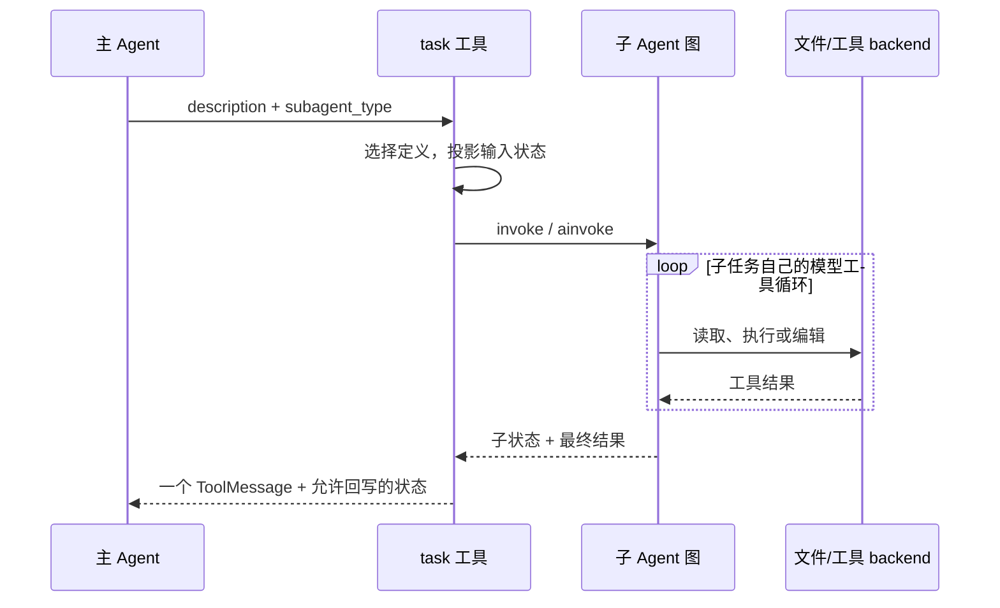

# Deep Agents / LangGraph：从上下文委派到持久化异步任务

> 核查日：2026-09-22。源码基线：Deep Agents `0a6bd899a0760af76bca025ea6af39997b78e611`；LangGraph `49cce0ca852be4cfb567a1cbe0e511ff325a1682`。二者均为当天固定的主线快照，不能等同某个发布标签。静态阅读，未运行上游。

## 1. 它解决什么问题，为什么值得重点看

设想用户要求“理解现有后端，为前端补上批量导出，并检查兼容性”。单个 Agent 可以完成，但搜索后端接口、阅读前端状态管理、运行工具的大量中间信息会占据同一个上下文。Deep Agents 的基本设计是：主 Agent 保留目标和综合决策，把能够局部完成的工作交给另一个完整的模型—工具循环，只收取必要结果。它首先改变的是信息流和上下文分配，其次才是并行速度。

这里有三个不同层次。LangGraph 负责状态、执行步骤、检查点和中断；LangChain 的 `create_agent` 负责模型与工具循环；Deep Agents 在上面组装计划、文件系统、记忆、Skill、子 Agent 和压缩等能力。Deep Agents 没有另造一套底层运行时。这种分层使“改变子任务收到什么上下文”可以落在 middleware，而“进程重启后恢复哪个步骤”仍由图运行时解决。[架构说明][architecture]

它与 Agent Teams 的关键区别是：内联 `task` 的自然语义是调用一个工作单元并收回结果。成员间持续互发消息、自主认领共享任务、保持长期团队身份，并不是这一接口自动提供的保证。异步子 Agent 增加了任务生命周期，但仍不能仅凭异步执行就称为对等团队。

## 2. 仓库如何组织，修改应落在哪里

| 层次 | 关键位置 | 状态与职责 | 修改的传播范围 |
| --- | --- | --- | --- |
| SDK 装配 | `libs/deepagents/deepagents/graph.py` | 解析模型 / profile，装配主 Agent 与子 Agent 的 middleware | 增减默认能力需要检查主、子两套栈 |
| 同步委派 | `middleware/subagents.py` | 子类型目录、输入投影、调用和结果投影 | 修改 fork 不能只改 prompt，还需调整状态白名单与回传 |
| 异步委派 | `middleware/async_subagents.py` | 远程 thread / run 身份、任务表、查询 / 更新 / 取消工具 | 影响远程协议与本地持久状态，不能混入同步 `task` 的返回语义 |
| 文件与执行 | `backends/`、`middleware/filesystem.py` | 决定文件位于图状态、Store、本机还是 sandbox | 共享内容与工具权限由 backend / policy 决定 |
| 终端产品 | `libs/code/` | 会话管理、UI、命令和产品资源 | SDK 可以独立使用，不能将 CLI 行为反推为 SDK 保证 |
| 底层调度 | LangGraph `pregel/`、`channels/` | 并发步骤、写集合、检查点与状态重建 | 不属于 Deep Agents 的任务提示词层 |

依赖方向是 SDK 装配 → LangChain Agent → LangGraph 执行；middleware 调用 backend 接口。开发者新增一个领域子 Agent 时，应先提供定义或编译后的 runnable；只有需要改变共通委派机制时，才修改 `SubAgentMiddleware`。直接在图引擎增加“研究员 / 程序员”的特殊判断会破坏这条边界。[装配源码][graph] [同步委派源码][subagents]

## 3. 启动：先定义能力，再产生执行实例

`create_deep_agent()` 先解析 backend 和 profile，再组装主 Agent 的工具与提示词。子 Agent 可以是声明式 `SubAgent`，也可以是调用方已经编译的 `CompiledSubAgent`。前者由 SDK 构造模型循环；后者是黑盒 runnable，但状态必须包含 `messages`，否则无法采用统一的结果回传路径。

这意味着“子 Agent 定义”和“本次任务实例”不是一个对象。定义说明可选的名称、描述、模型和能力；模型发出的 `task(description, subagent_type)` 才产生一次具体调用。名称是路由键，源码因此拒绝重复子 Agent 名称。描述则进入模型可见目录，决定它能否选对专家。

主 Agent 与子 Agent 分别拥有 middleware 栈。仅给主 Agent 加入审计、压缩或工具策略，并不能假定所有自定义编译子图都自动具有相同行为。当前装配还允许按各自模型解析 profile；模型差异通过装配解决，而不是在每个业务工具中反复分支。[装配源码][graph] [定义与构造][subagents]

## 4. 输入如何进入子 Agent：isolated 与 fork

### 4.1 isolated：隔离消息历史，不等于隔离全部状态

默认模式下，子 Agent 的消息输入是一条包含委派说明的 `HumanMessage`。主 Agent 的历史对话和 todo 不直接复制过去，避免子 Agent继续执行主任务，或将父级计划误当成自己的计划。

但这不能简化成“子 Agent 从零开始，完全不共享状态”。`_validate_and_prepare_state` 会复制没有被排除的状态字段；`messages`、`todos`、`structured_response`、Skill 元信息以及 private state 等有专门规则。应用自定义的共享字段可能继续进入子任务。它更准确的含义是**消息历史隔离，同时按契约投影状态**。

因此，适合的委派输入应该提供局部目标、涉及范围、已确认事实、必要来源位置和希望返回的内容。例如“检查导出 API 是否支持分页，给出函数位置和边界条件”，比“帮我看看后端”更能控制任务规模。这是调用方的任务设计建议，不是 SDK 自动补全的机制。

### 4.2 fork：继承有效上下文，而不是复制整个世界

当前源码支持实验性的 `mode="fork"`。它继承父会话的有效对话并追加本次任务；若父会话已经压缩，`_fork_messages` 先应用压缩事件，避免重新灌入已经移出的原始历史。声明式 fork 可以继承相容的 private channels；编译子图是不透明对象，因此采用更保守的字段投影。

fork 不继承旧的 `structured_response` 和摘要会话身份，防止把父级旧输出当成新结果。fork 的 `task` 工具还有递归限制，避免子 Agent再次把继承的“请委派任务”指令当作自己应执行的最新命令。fork 也不能自行指定与父级相冲突的 Skill 集合。

fork 只是上下文分叉。它不创建 Git worktree，不复制文件，不赋予独立操作系统权限，也不建立与父历史持续同步的通道。父级后来收到的新要求，需要新的输入或显式接续机制。[输入、fork 与回传实现][subagents]

## 5. 同步委派如何执行、并行、返回

源码中的 `atask` 虽然是异步 Python 函数，仍然 `await subagent.ainvoke(...)`。这里的 async 表示不阻塞事件循环，不表示立即返回后台任务 ID。多个内联工具调用能否并行，还取决于上层工具执行节点与配置；不能根据函数名就推断无限并发。

结果回传优先使用结构化输出，否则逆序寻找最后一个非空 AI 文本。然后构造与父工具调用 ID 配对的 `ToolMessage`。子 Agent 的全部搜索轨迹不会自动进入父消息历史。允许回传的其他状态通过 `Command(update=...)` 合并，子 todo 和内部状态仍受排除规则约束。

这是上下文节省的真正来源：完整过程留在子链路，父级收到结论和必要状态。代价是摘要可能遗漏证据，因此产品仍应提供子任务历史与来源回读入口。结构化输出只能约束形状，不能证明“测试已通过”是真的。[返回实现][subagents]

## 6. 异步远程任务：thread 是任务身份，run 是一次执行

`AsyncSubAgentMiddleware` 是另一条调用路径。它通过 LangGraph SDK 调用兼容 Agent Protocol 的服务，可以是托管部署，也可以是自建服务。这里的 Agent Protocol 是 LangChain 体系的接口，不能写成 Google / Linux Foundation 的 A2A 协议。[异步接口说明][async-reference]

启动工具先创建远程 thread，再在其上创建 run，随后将 `task_id / agent_name / thread_id / run_id / status / 时间字段` 写回父图的 `async_tasks`。本次实现让 `task_id` 等于 `thread_id`，后续接续只更换 `run_id`。任务表使用按 ID 合并的 reducer，因此不依赖一段聊天文本是否仍留在上下文中。

这一身份拆分十分重要。如果一个子任务初次失败，用户补充信息后继续，它仍是同一个业务任务，但会产生新的执行。若只存“最近一次结果”，主 Agent可能把旧轮成功结果误当成本轮结果；若每次都换任务身份，又会丢失接续关系。

当前工具组包含启动、检查、更新、取消和列表。更新不是单纯塞入一条无副作用邮箱消息：源码调用 `runs.create(..., multitask_strategy="interrupt")`，中断当前 run 并在相同 thread 上创建新的 run。调用方必须清楚这是会改变执行的操作。取消则发出远程 cancel，再更新本地任务记录；它不能证明远程已经发生的文件写入、网络请求或业务动作被撤销。[异步任务实现][async]

还有一个容易忽略的故障窗口：远程创建成功与本地图 checkpoint 提交并非同一个事务。若进程在两者之间退出，远程工作可能存在而本地任务表尚未记录。源码没有因此获得跨系统 exactly-once 保证。做生产接入时，应该针对这条边界设计请求身份、查询对账和可见的未知状态，而不是将“有 checkpointer”解释为绝不重复执行。

## 7. 图状态、文件状态、长期记忆是三件事

LangGraph 的 Pregel runner 并发执行当前步骤中的任务，收集写入，再由运行时推进下一步。不同节点对同一字段的写入需要相应 channel / reducer 定义；这是共享状态的合并规则，不是共享源文件的合并算法。[执行器][runner]

当前 Deep Agents 的消息状态使用 DeltaChannel。其思想是保存增量并周期性保存完整快照，恢复时重放增量，避免每一步都重复保存不断增长的整段历史。当前源码将 DeltaChannel 标记为 beta，要求 reducer 具有确定性和批次无关性：把两批写入分开合并或一次合并，应得到相同结果。不是任意“最后写入覆盖”函数都适合重建。[增量通道][delta]

文件则由 backend 决定：默认 state backend 的文件属于图状态；Store 可以跨线程保存；filesystem / sandbox backend 指向真实执行环境。对话恢复与文件恢复不能混淆：恢复旧 checkpoint 并不自动撤回真实磁盘上的一次编辑。多个子 Agent访问同一个 backend，也不会因此自动获得文件冲突检测或独立目录。

Skill 和记忆通过 middleware 注入、按需读取或 backend 路由参与上下文。它们是能力和知识，不负责认领任务、持有并发槽或控制子进程。MCP 同样只是外部能力来源；把所有 MCP 工具暴露给所有子 Agent，并不等价于合理的团队能力分工。[架构与状态说明][architecture]

## 8. 演化路径与适用边界

官方 2026-04-07 的 v0.5 公告增加异步远程 subagent；5 月的增量通道说明讨论长运行状态增长；6 月又介绍动态子 Agent。与本次固定主线对照，可以看到它从“工具包装的隔离子任务”，逐渐扩展到“多种上下文模式、可接续远程任务和更低成本的持久化”。这些日期是相应公告时间，不是所有主线代码的发布日期。[v0.5][v05] [增量状态背景][delta-blog] [动态子 Agent][dynamic]

适合采用的场景包括资料检索、代码探索、按模块分解的实现、远程长任务。需要大量直接互相讨论、持续认领共享工作项的团队，则要额外提供任务板、成员身份、消息与调度规则。Deep Agents 可以成为这种团队中每个成员的 harness，但它自身的 `task` 工具不能替代整个团队控制层。

## 9. 对本项目最有价值的参考

本项目已有完整 SessionService、Goal、worker 和持久化记录，因此吸收重点应是**委派契约与状态边界**：区分定义 / 实例、任务 / 执行，明确 isolated / inherit 的材料来源，默认返回紧凑结论并保留过程回查。现有 worker 已有部分相同机制，应改善可理解性与可见性，而不是重新实现同名接口。

同步调用与后台任务可以保持不同工具语义。对普通通知继续保留“收到消息不自动启动空闲会话”的产品规则；不要因为上游更新工具采用 interrupt，就将所有同伴消息改成强制打断。远程服务只有出现真实需求时再接入，届时必须处理上述创建与持久化之间的故障窗口。

从代码组织看，值得借鉴的是显式装配、上下文投影和 backend 分层。无需为了采用这些思路而把现有 Python 循环整体替换成 LangGraph，也不应把增量 checkpoint、Skill、MCP 或 sandbox 当成启动协作的前置条件。

[architecture]: https://github.com/langchain-ai/deepagents/blob/0a6bd899a0760af76bca025ea6af39997b78e611/libs/ARCHITECTURE.md
[graph]: https://github.com/langchain-ai/deepagents/blob/0a6bd899a0760af76bca025ea6af39997b78e611/libs/deepagents/deepagents/graph.py
[subagents]: https://github.com/langchain-ai/deepagents/blob/0a6bd899a0760af76bca025ea6af39997b78e611/libs/deepagents/deepagents/middleware/subagents.py
[async]: https://github.com/langchain-ai/deepagents/blob/0a6bd899a0760af76bca025ea6af39997b78e611/libs/deepagents/deepagents/middleware/async_subagents.py
[runner]: https://github.com/langchain-ai/langgraph/blob/49cce0ca852be4cfb567a1cbe0e511ff325a1682/libs/langgraph/langgraph/pregel/_runner.py
[delta]: https://github.com/langchain-ai/langgraph/blob/49cce0ca852be4cfb567a1cbe0e511ff325a1682/libs/langgraph/langgraph/channels/delta.py
[async-reference]: https://reference.langchain.com/python/deepagents/middleware/async_subagents
[v05]: https://www.langchain.com/blog/deep-agents-v0-5
[delta-blog]: https://www.langchain.com/blog/delta-channels-evolving-agent-runtime
[dynamic]: https://www.langchain.com/blog/introducing-dynamic-subagents-in-deep-agents
