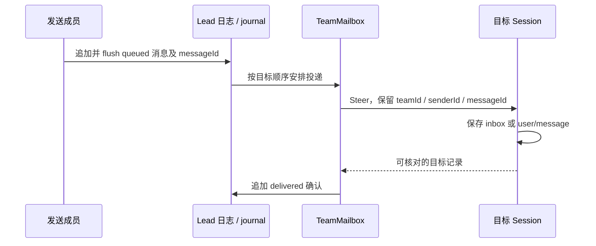

# Agent Teams：从可继续的成员到共享任务与可靠收件箱

> 核查日：2026-09-22。本文分别分析 Claude Code 2.1.88 历史源码、当前官方产品契约，以及 DeepSeek Harness 0.1.6-alpha.2 的开源实现。三个基线不可混用。当前 Claude Code 内部实现不公开；历史 source map 镜像不是官方开源仓库，也不能据此推定源码复用许可。

## 1. 为什么团队不能用“并行调用几个模型”解释

假设一个任务需要后端设计接口、前端同时做页面、审查员持续检查两者的约定。普通子 Agent 可以分别返回三个答案，但团队还要解决：前端如何在后端尚未结束时获得接口变更；成员结束一轮后能否接着处理追问；谁拥有当前工作；主 Agent 退出后哪些东西仍存在。

Agent Teams 的核心因此是四组对象：成员身份、各自的会话、共享工作项、成员间消息。工作项和成员不是一一对应：同一个成员可以连续处理多个工作项，一个工作项也可能经历换人、退回和重新打开。模型负责判断怎么分工，宿主负责保留身份、投递消息、执行状态转换。这与 [Deep Agents 的调用式委派](02-deepagents-langgraph.md) 构成两条不同的实现路线。

## 2. Claude Code 2.1.88：历史版本如何组织代码

历史镜像固定在 `4e5426b82ab19c81244f165b4f18306944b8a169`。更完整的单 Agent 架构见 [原调研](../agents/claude-code-v2.1.88.md)。本节仅讨论这个版本，不能反推后续版本。

| 位置 | 负责的状态和动作 | 为什么这样拆分 |
| --- | --- | --- |
| `src/tools/TeamCreateTool/`、`TeamDeleteTool/` | 显式建队与清理入口 | 将模型动作转成宿主操作；并非调度循环本身 |
| `src/utils/swarm/` | 成员启动、运行后端、成员上下文 | 区分同进程执行与终端进程展示 |
| `src/tasks/InProcessTeammateTask/` | 成员运行状态、会话消息、停止请求 | 接入产品已有后台 Task 生命周期与 UI |
| `src/utils/teammateMailbox.ts` | 收件箱文件及协议消息 | 普通通信、空闲通知、权限消息共用传输，但有不同类型 |
| `src/hooks/useMailboxBridge.ts` | 收件箱与交互状态之间的桥接 | 文件存在不代表模型已经看见，需要运行时接入 |
| `src/tools/TaskListTool/` 等 | 工作项的模型接口 | 与运行中的 teammate Task 是两个层次 |

这种仓库组织是对现有 coding harness 的扩展：复用已有会话、工具、后台任务和 UI，而不是引入另一套完全独立的 Agent 框架。代价是团队运行会接触 AppState、ToolUseContext、权限和工具装配；不能仅抽走一个 Team 工具就得到可独立使用的 SDK。[历史任务实现][old-task] [历史收件箱][old-mailbox]

### 2.1 从创建到执行：长生命周期身份与短生命周期回合

同进程 teammate 通过独立的 Agent 身份和异步上下文运行，仍共享 Node.js 进程。其状态可以在执行与空闲之间转换；用户注入的消息进入 `pendingUserMessages`，不是直接修改当前在途模型请求。停止请求也写入状态，由执行链路处理。

由此可以推导一个重要边界：成员“这一轮结束”不等于成员“永久销毁”。UI 应能够保留名字、历史和后续通信入口。反过来，同进程隔离的是运行上下文，不是操作系统权限、文件系统或故障域。一个 Node.js 进程崩溃可能影响多个成员，异步上下文也不能阻止两个工具写同一个文件。

### 2.2 消息怎样进入另一个成员

历史 `writeToMailbox()` 先确保收件箱存在，再获取 `proper-lockfile` 文件锁；取得锁后重新读取 JSON 数组、追加 `read: false` 的消息，写回并释放锁。重新读取发生在锁内，解决的是两个发送方基于相同旧数组相互覆盖的问题。[历史收件箱 L134–192][old-mailbox]

但该实现不是跨会话事务：文件写入、模型读到、执行动作、更新任务状态仍是不同步骤。尤其该快照的读取失败会记录日志后返回空数组，写入异常也在函数内记录后结束。单看调用成功返回，调用者无法获得充分的投递失败信息。它适合说明历史产品如何快速构建本机团队，也暴露出收件箱错误语义后来必须改进的原因。

同一个文件还定义 `idle_notification`、`permission_request`、`permission_response` 等结构。它们不能都被解释为用户文字：空闲通知用于调度，权限响应必须与对应请求匹配，普通消息则提供协作信息。一个可靠实现需要保留来源和类型，而不是把所有内容都拼进“用户说”的 prompt。

### 2.3 历史实现值得吸收什么

它把“成员长期存在”和“每一轮短暂执行”分开，这对桌面应用很自然；已有的运行观察、停止按钮和消息展示可以复用。文件邮箱降低了单机部署成本，但整文件更新、读错误隐藏、跨进程争锁和崩溃恢复都需要单独评估。不能因为有锁就写成可靠分布式消息系统。

## 3. 当前 Claude Code：公开契约已经如何演化

### 3.1 用户接入与建队

当前官方仍将 Agent Teams 标为实验功能。文档以 v2.1.178 起的变化为界：启用后，命名 Agent 可成为 teammate；团队随会话建立和清理，旧 `TeamCreate/TeamDelete` 已移除。它面向交互式使用，不能把 `-p` 或 Agent SDK 的普通子 Agent 当成同一产品入口。[当前 Teams][current]

这次演化减少了模型需要正确完成的仪式性步骤。设计上的参考是：如果一个团队天然依附当前任务，团队身份可以由宿主提供，模型只表达分工，不必先生成并维护一个“团队名称配置”。这是本研究的设计推论，不是对闭源内部代码的描述。

### 3.2 成员得到什么上下文和能力

当前成员有独立会话上下文，接收委派说明并加载项目资源。子 Agent 定义还可控制工具、预加载 Skill 与记忆目录；MCP 的名字引用可复用父连接，内联定义有自己的连接生命周期。因此要分别记录“定义能看见什么”“实际连接何时存在”“这一轮获准调用什么”。[子 Agent 配置][subagents]

Skill 预加载与模型自行发现 Skill 也不是同一件事。前者把内容放入初始上下文，后者保留按需加载的入口。多成员系统如果把所有 Skill 正文复制给每个成员，可能在没有增加能力的情况下扩大上下文成本。工具白名单本身也不等于执行沙箱：保留 Bash 时，实际文件和网络能力还由执行环境决定。

### 3.3 通信、任务、结束和恢复

共享任务支持认领和依赖；邮箱负责成员通信。任务是否完成与成员是否空闲须分别判断。当前产品仍存在进程恢复限制：持久任务表不能自动还原所有活跃 teammate。默认同进程模式适合普通终端，分屏运行又有终端环境约束。[当前 Teams][current]

错误文档给出了更具体的演化证据：v2.1.224 之前，写入邮箱失败也可能被报告为发送成功；当前会向发送方返回失败。关闭确认丢失还可能出现“成员已经退出，但主会话没收到确认”的情况。这说明必须把动作完成和通知成功分开建模，不能用一个 `success` 覆盖所有阶段。[当前错误契约][errors]

另外，官方另有跨会话通信功能，连接用户自己运行的会话。它与依附主会话的团队不是同一种生命周期。今天也不能再用“所有普通子 Agent 都不能互发消息”作为永久分类标准；分类应检查身份、调度权和状态归属。[跨会话通信][cross-session]

## 4. DeepSeek Harness：开源实现提供了更清楚的持久语义

基线是 `ddefc45fbc7f8e46dd73185e68295696d1297887`，即此前研究的 0.1.6-alpha.2。不是重新取得的 9 月 22 日主线；该限制刻意保留。实验模块位于 `packages/experimental/`，不应称为已验证的稳定生产功能。[版本源码][dsh]

### 4.1 从任务进入到身份建立

TeamId 是根 SessionId 的品牌类型；teammate 的持久身份也是 SessionId，名字只是不可变的模型 / UI 标签。成员的 provisioning、active、failed 表达创建事实；running、idle、inactive 则表达此时是否加载和执行。这避免把“程序重启导致成员未加载”误报成成员创建失败。

仓库拆分为 `agent-team` 领域服务、`tool-agent-team` 模型工具、`client-ui-agent-team` 界面适配。领域服务内部又分 journal、roster、mailbox、task-board、projection、lifecycle。新增一种团队事件，应先定义持久事实与重放，再接工具和 UI；只改一个面板会让恢复后状态无法重建。[领域包][dsh-package]

### 4.2 委派上下文与工作目录

成员支持 fresh / fork 上下文方式，底层仍使用既有 subagent 和 Session 机制。共享 checkout 是产品选择，任务的 `writeScopes` 是路径提示，重叠只产生诊断，既不是文件锁，也不是 sandbox。对本项目而言，这种显式表达比“每开一个成员默认复制仓库”更符合现有默认原目录协作的方向。

### 4.3 一条消息的完整数据流

`sendAdmitted()` 在 Lead journal 的事务范围内分配消息、检查收件箱数量与完整消息大小、追加并 flush `team/message/queued`。投递在释放该范围前登记，确保并发发送顺序与日志顺序一致。`dispatchTails` 按目标串行安排投递，`inFlightMessages` 防止同进程重复在途。[邮箱源码][dsh-mailbox]

关键崩溃窗口是：目标已经记录消息，但 Lead 还未记录 delivered。恢复时不能仅根据 Lead 的 queued-minus-delivered 重发；实现会检查目标 inbox / history 中的 messageId，发现已记录就补确认。`checkpointDelivered()` 也先 flush 目标，再记 Lead delivered。因此它提供的是有身份的投递与接收去重机制，不是保证模型只产生一次外部副作用。

目标运行中时在步骤边界接入；空闲目标可启动回合，未加载成员可冷恢复。这是 DSH 的具体产品策略。本项目“普通消息不自动启动空闲会话”“实际执行故障停止并待明确接续”的规则不同，不能为了模仿 DSH 就更换这些语义。

### 4.4 共享任务怎样避免抢占和覆盖

`task-board.ts` 每次修改读取当前 revision，比较调用者 expectedRevision，验证动作和依赖图，再写入完整新快照并递增 revision。认领、释放、完成、重开和删除有不同含义；删除保留 tombstone，使历史关系仍可解释。任务依赖须无环，完成状态用于判断可认领工作。[任务板源码][dsh-board]

这里的 CAS 保护“两个成员同时改工作项”这一具体竞争，不能防止两个任意 shell 同时修改源文件。相反，writeScopes 留作提醒，不让任务元数据变成每次文件写入的新审批层。这种职责边界尤其值得本项目参考。

### 4.5 结束与恢复

Team 状态从根 Session 事件折叠得到，按 TeamId 过滤。普通 fork 继承的历史不能因此混进新团队的现行状态。等待工具订阅领域或成员变化，然后重新读取事实；不要求模型不断发送“你做完了吗”。停止当前成员回合也不等于删除其收件箱或任务所有权。[领域说明][dsh-domain]

持久消息、任务重放与进程句柄恢复是不同问题。模型请求、命令执行和磁盘副作用不能通过重放团队日志自动复原。源码中精细的确认与去重解决的是前者，本次静态阅读没有实际验证断电恢复或高并发。

## 5. 对本项目最直接的参考

最适合吸收的是四个分离：成员身份与 Run 分离；工作项与会话分离；消息投递与任务完成分离；任务写范围提示与真实文件冲突检查分离。它们能在现有 Delegation / Collaboration / SessionService 上逐步形成团队层。

Claude Code 的演化提示应减少建队仪式并保留直观成员 UI；DSH 的实现提示应把需要恢复的事实放入持久事件，并解释投递回执的含义。两者都不能证明增加成员必然加速。若前端任务一直依赖尚未确定的后端接口，多开成员只会增加等待和返工；需要先把可并行部分与接口交接点说清楚。

后续具体方案见 [本项目借鉴与演化建议](12-project-implications.md)。这里没有建议强制任务 DAG、自动恢复失败请求、强制独立 worktree 或新增逐项验收门槛。

[old-task]: https://github.com/Shengfu-Zhang/claude-code-public-package-extract/blob/4e5426b82ab19c81244f165b4f18306944b8a169/src/tasks/InProcessTeammateTask/InProcessTeammateTask.tsx
[old-mailbox]: https://github.com/Shengfu-Zhang/claude-code-public-package-extract/blob/4e5426b82ab19c81244f165b4f18306944b8a169/src/utils/teammateMailbox.ts
[current]: https://code.claude.com/docs/en/agent-teams
[subagents]: https://code.claude.com/docs/en/sub-agents
[errors]: https://code.claude.com/docs/en/errors#failed-to-write-to-a-teammates-inbox
[cross-session]: https://code.claude.com/docs/en/cross-session-messaging
[dsh]: https://github.com/deepseek-ai/deepseek-harness/tree/ddefc45fbc7f8e46dd73185e68295696d1297887
[dsh-package]: https://github.com/deepseek-ai/deepseek-harness/blob/ddefc45fbc7f8e46dd73185e68295696d1297887/packages/experimental/agent-team/README.md
[dsh-mailbox]: https://github.com/deepseek-ai/deepseek-harness/blob/ddefc45fbc7f8e46dd73185e68295696d1297887/packages/experimental/agent-team/src/mailbox.ts
[dsh-board]: https://github.com/deepseek-ai/deepseek-harness/blob/ddefc45fbc7f8e46dd73185e68295696d1297887/packages/experimental/agent-team/src/task-board.ts
[dsh-domain]: https://github.com/deepseek-ai/deepseek-harness/blob/ddefc45fbc7f8e46dd73185e68295696d1297887/docs/subsystems/agent-team.md
