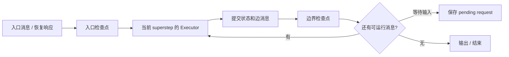

# AutoGen → Microsoft Agent Framework：从消息运行时到可恢复工作流

> 核查日：2026-09-22。AutoGen 固定 `027ecf0a379bcc1d09956d46d12d44a3ad9cee14`；Microsoft Agent Framework（MAF）固定 `98a982a147212424d766ed993e6ecda13abe5faf`。本次深入阅读 Python 实现，未审查 .NET 执行路径、部署到 Azure 或运行模型。

## 1. 先更新项目状态，再谈架构

当前 AutoGen 官方仓库明确进入维护模式，并引导新用户使用 Microsoft Agent Framework；其说明将 MAF 1.0 标为生产可用。因而把 AutoGen 0.2 的群聊示例当成微软当前推荐架构，会同时漏掉中间的 0.4 运行时重构和新的 MAF 路线。这里的“生产可用”是上游发布定位，不是本次对可用性或性能的验证。[当前 AutoGen 声明][autogen-readme]

三代设计解决的问题不同：早期重点是把多个会话角色连起来；AutoGen 0.4 强化事件驱动 runtime 与高层 AgentChat 分离；MAF 进一步把 Agent 接入类型化工作流、检查点和人机交互。不能把它们当作仅更换包名。[0.4 架构说明][autogen-blog] [官方迁移指南][migration]

## 2. AutoGen 0.4 路线：一条消息如何驱动一组 Agent

### 2.1 仓库三层

`python/packages/autogen-core/` 提供 AgentId、消息、topic、订阅、取消与 runtime；`autogen-agentchat/` 提供面向对话的 Agent、Team、选择发言者和终止条件；`autogen-ext/` 放模型客户端、执行器及扩展。业务使用群聊不必直接编写消息运行时，但开发新的调度方式时应清楚它最终依赖什么。[运行时源码][autogen-runtime] [Team manager][autogen-manager]

这种组织避免让每一种 Team 都重新管理通信和实例生命周期。它也让“Agent 可以接收消息”与“Agent 如何用模型生成回复”解耦，运行时可以支持非 LLM 的参与者。

### 2.2 消息入口与实例化

`SingleThreadedAgentRuntime` 区分发送到具体接收者的 SendEnvelope、发布到 topic 的 PublishEnvelope，以及响应信封。Agent 工厂按类型登记，具体实例按身份创建。消息中带接收方、取消和响应关联，宿主才能知道某条错误属于哪个调用。

“SingleThreaded”不能理解为所有 Agent 严格串行。它使用单一异步事件循环与队列，但消息处理可在独立 asyncio task 中推进；等待模型网络响应时其他消息仍可执行。线程数、Agent 数、并发请求数和分布式节点数是四个不同指标。[运行时源码][autogen-runtime]

### 2.3 群聊怎样选择下一步

AgentChat 的 manager 保存 message_thread、活跃发言者和终止条件。收到成员回复后，它将增量消息记入线程，再选择下一位或下一组发言者并发送请求。选择器可以是轮询或模型策略；终止则在宿主明确检查。

它的自然工作单位是对话发言，而非带文件所有权的代码工作项。一个成员说“我完成了”只是输入，除非应用把它接到其他领域规则。共享对话有利于辩论和轮流修订，但长历史会反复进入多个模型；成员越多，上下文复制与选择器调用越需要观察。

## 3. MAF：同一问题被重新拆成哪些包

| 路径 | 负责什么 | 为什么对迁移有意义 |
| --- | --- | --- |
| `python/packages/core/agent_framework/` | Agent、模型响应、Session、工具等协议 | 保留业务 Agent 的基本运行界面 |
| `core/agent_framework/_workflows/` | Executor、edge、状态、superstep、checkpoint | 多 Agent 是图节点的一种，不是唯一节点 |
| `packages/orchestrations/agent_framework_orchestrations/` | Sequential、Concurrent、GroupChat、Handoff、Magentic builder | 高层模式编译到共通工作流 |
| 各 provider / integration package | 外部模型和平台适配 | 不把服务 SDK 写进图调度器 |

迁移重点不是把 `Team` 换成 `Workflow`：原群聊历史怎样存、谁决定下一步、原中断如何对应 request-info、工具副作用如何恢复，都要逐项确认。官方给出 RoundRobin、Selector、Swarm 等对照，但业务行为仍需重新核对。[迁移指南][migration]

## 4. 第一步：选择协作模式，并形成可执行图

### 4.1 Sequential 与 Concurrent

Sequential 表达顺序交接；ConcurrentBuilder 则构造 dispatcher → fan-out → participants → fan-in → aggregator。默认聚合器收集成员最终回答形成结果，不自动进行质量投票、冲突裁决或代码合并；需要综合判断时，应用可替换为回调、Executor 或额外 Agent。[并行实现][concurrent]

例如三个 Agent 分别审查性能、兼容性和可维护性。fan-in 能保证汇合点拿到各分支结果，但“这些建议是否相互矛盾”仍是业务问题。把 fan-in 画在图上不能替代综合逻辑。

### 4.2 GroupChat 与 Handoff

GroupChat 的中心 orchestrator 持有状态，调用 selection function 决定发言者，并向参与者同步消息。Handoff 则由当前 Agent 通过工具选择下一位，控制权沿交接路径转移；它不是中心节点每轮点名。当前 handoff 还明确支持用户介入与自主运行的不同模式。[群聊实现][groupchat] [交接实现][handoff]

如果任务像客服分流，交接后由专家持续处理很自然；如果是代码评审，需要不同视角按轮次互相检验，GroupChat 更容易观察。若任务是同时修改独立文件，二者都还缺少工作区协调和集成策略，不能直接等同 coding Agent Teams。

### 4.3 Magentic

Magentic 管理器维护事实 / 计划组成的 task ledger，以及是否满足目标、是否陷入循环等 progress ledger，并记录 round、stall、reset 等计数。它给管理 Agent 一套持续调整计划的状态，而非只在初始 prompt 写“你负责管理”。[Magentic 源码][magentic]

这套结构适合开放任务，代价是增加管理模型调用，并可能把管理器的错误判断放大。ledger 是模型对局面的估计，不能冒充真实命令或文件事实。本项目可吸收“目标与进展分开”，不必把 ledger 完整填写变成正常执行前提。

## 5. 第二步：AgentExecutor 管理成员上下文

AgentExecutor 是业务 Agent 与图运行时之间的桥。其可保存状态包含 cache、full_conversation、agent_session、pending_agent_requests 和待送回的响应。cache 表示尚未交给 Agent 的消息，full_conversation 表示已形成的对话，pending 请求表达未完成交互；这些不能被一份字符串摘要替代。[AgentExecutor][agent-executor]

对多轮 UI 来说，用户输入应先路由到准确的 pending request，再推进对应执行。不能因为两个 Agent 都在等待，就把同一回复广播为两个问题的答案。对模型上下文来说，观察者可见的完整事件也不必全部放入每个 Agent 的下一次请求。

MCP / 工具连接、执行环境和应用记忆属于 Agent 与平台配置；Workflow 提供组合和状态推进，不自动建立每位成员的独立 OS sandbox。Session 可保存对话，也不等于团队共享长期知识库。

## 6. 第三步：superstep 怎样推进，状态何时提交

Runner 采用消息驱动的 superstep：消费本步可处理消息，运行对应 Executor，暂存状态变化和输出，再在边界提交并形成后续步。没有新消息时达到运行时意义上的收敛，或因等待用户、失败、迭代上限等原因停止。[Runner][runner]

事件流和迭代执行分别等待。流式消费者取消或关闭生成器时，Runner 会取消在途迭代和事件等待任务并 gather 清理，避免 UI 关闭后仍遗留后台计算。底层工具是否杀掉子进程则仍取决于执行器实现，不能仅凭 asyncio cancellation 推定。

## 7. 第四步：checkpoint 保存的不是只有聊天记录

WorkflowCheckpoint 包含已提交 state、消息、Executor 状态、fan-in 等边状态、pending request 和迭代信息。若只保存每位 Agent 的聊天记录，恢复时会丢失“聚合器已经收到了哪几个分支”，导致重复等待或重复汇总。[Checkpoint][checkpoint]

入口 checkpoint 在任何 Executor 执行前保存输入；后续 checkpoint 在 superstep 边界生成。同一个 iteration_count 可以有多个 checkpoint，例如等待用户和用户回答刚进入时都在同一个边界。判断最新状态依赖前序 checkpoint 链和时间，不能拿迭代数当唯一版本号。

恢复会校验图签名，并清空旧共享状态再导入快照，避免重复使用同一个 Workflow 对象时混入上一轮值。对本项目的启示是：若以后支持可执行工作流，需要记录工作流版本与节点身份；当前描述性阶段模板不应提前承担这种强约束。

当前 Runner 在边界 checkpoint 写入失败时记录警告并保留最后成功的 lineage，未直接使运行失败。这个取舍只适用于它的 checkpoint 语义；若本项目写入的是用户成果或权威会话记录，不能照搬“保存失败继续”而违背现有数据规则。恢复点保存成功也不保证所有外部副作用具有原子性。[Runner 保存分支][runner]

## 8. 本项目应吸收的演化经验

微软路线显示：灵活群聊最终会遇到可恢复状态、类型化输入输出和 HITL 的需求。但它没有证明所有应用都应先构造大图。本项目目前适合保留自由会话和明确委派，只对反复出现、确有恢复需要的模式建立可执行编排。

近期有价值的参考是统一成员事件、子 Agent 输入输出投影、结果汇合与用户问题的准确路由。更重的 superstep / durable workflow 可以作为后续选项。AutoGen 的实际迁移成本也提醒我们，不要让 UI、存储和业务配置直接依赖某个外部框架内部类型。

[autogen-readme]: https://github.com/microsoft/autogen/blob/027ecf0a379bcc1d09956d46d12d44a3ad9cee14/README.md
[autogen-blog]: https://www.microsoft.com/en-us/research/blog/autogen-v0-4-reimagining-the-foundation-of-agentic-ai-for-scale-extensibility-and-robustness/
[migration]: https://learn.microsoft.com/en-us/agent-framework/migration-guide/from-autogen/
[autogen-runtime]: https://github.com/microsoft/autogen/blob/027ecf0a379bcc1d09956d46d12d44a3ad9cee14/python/packages/autogen-core/src/autogen_core/_single_threaded_agent_runtime.py
[autogen-manager]: https://github.com/microsoft/autogen/blob/027ecf0a379bcc1d09956d46d12d44a3ad9cee14/python/packages/autogen-agentchat/src/autogen_agentchat/teams/_group_chat/_base_group_chat_manager.py
[concurrent]: https://github.com/microsoft/agent-framework/blob/98a982a147212424d766ed993e6ecda13abe5faf/python/packages/orchestrations/agent_framework_orchestrations/_concurrent.py
[groupchat]: https://github.com/microsoft/agent-framework/blob/98a982a147212424d766ed993e6ecda13abe5faf/python/packages/orchestrations/agent_framework_orchestrations/_group_chat.py
[handoff]: https://github.com/microsoft/agent-framework/blob/98a982a147212424d766ed993e6ecda13abe5faf/python/packages/orchestrations/agent_framework_orchestrations/_handoff.py
[magentic]: https://github.com/microsoft/agent-framework/blob/98a982a147212424d766ed993e6ecda13abe5faf/python/packages/orchestrations/agent_framework_orchestrations/_magentic.py
[agent-executor]: https://github.com/microsoft/agent-framework/blob/98a982a147212424d766ed993e6ecda13abe5faf/python/packages/core/agent_framework/_workflows/_agent_executor.py
[runner]: https://github.com/microsoft/agent-framework/blob/98a982a147212424d766ed993e6ecda13abe5faf/python/packages/core/agent_framework/_workflows/_runner.py
[checkpoint]: https://github.com/microsoft/agent-framework/blob/98a982a147212424d766ed993e6ecda13abe5faf/python/packages/core/agent_framework/_workflows/_checkpoint.py
