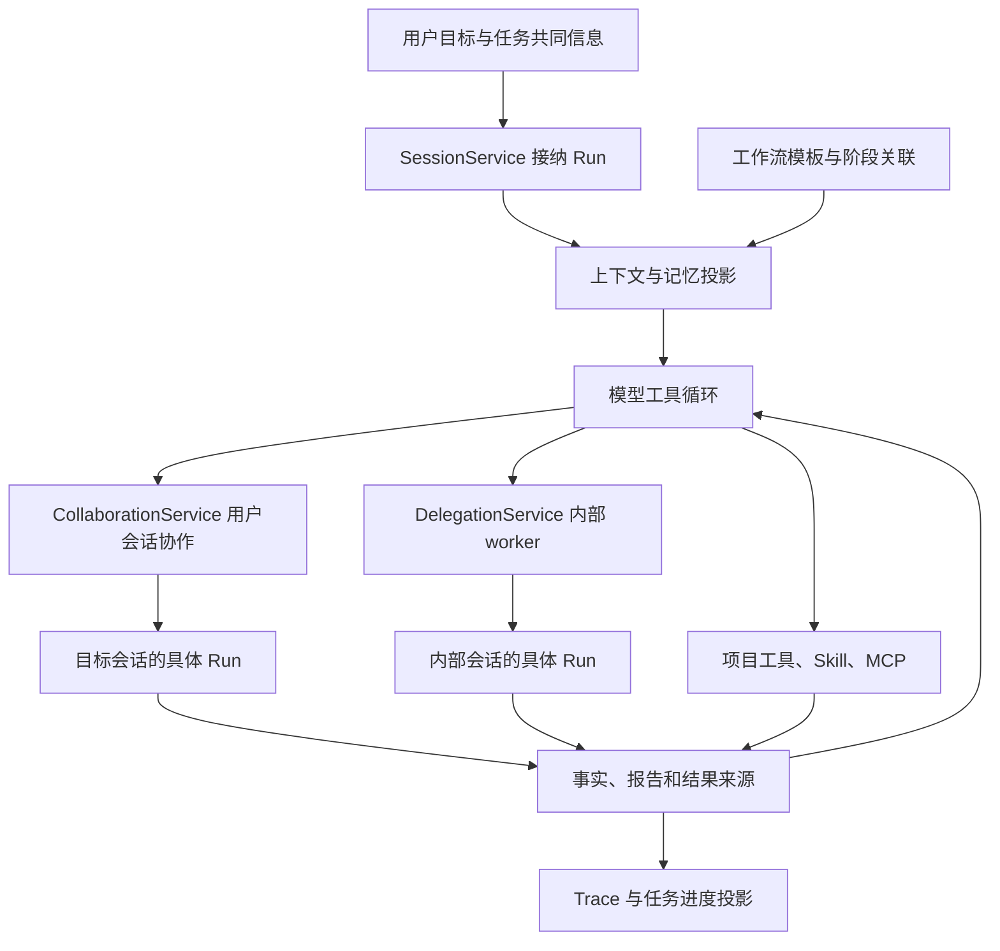

# 对本项目的参考：从现有协作能力走向可组合的多 Agent 框架

> 基线：2026-09-22 当日工作区，包含其他任务尚未提交的 M4 实现；这不是某个 Git 发布版本。本文只提出研究结论和候选改进，不构成新增功能、模型、依赖、自动调度或执行门槛的授权。源码核对范围及限制见 [证据登记](13-evidence-register.md)。

## 1. 先说结论与当前起点

本项目已经具备构建多 Agent 框架的主要底层零件：可接续会话、Goal、定向协作请求和消息、内部 worker、上下文 / 记忆、工具执行、共享任务信息，以及 M4 的 Skill、MCP、工作流模板和 Trace。下一步最有价值的工作，是让这些零件在一条清晰的数据流里组合，并把真实运行关系呈现给用户。

因此，本轮不建议引入整个 LangGraph、AgentScope 或 Deep Agents 来替换现有核心。它们值得借鉴的分别是状态投影、成员生命周期、任务调度与恢复边界。已有 `SessionService` 应继续执行模型与工具循环，协作层决定把什么工作交给哪个执行者。

9 月 21 日上一轮总结中“尚未接入 Skill / MCP”的说法属于当时快照。当前 [M4 进度](../../progress/m4.md) 与 [装配入口](../../../src/my_agent/bootstrap.py) 已能核对这些能力，本篇不会再次把它们列为从零建设项。

## 2. 一次任务现在怎样流动

这里的工作流模板进入任务说明与关联信息，**当前不是自动执行图**。`workflow/templates.py` 的模块说明和 `WorkflowStage` 都明确依赖是接续信息，不作为执行门槛。上图也没有把 renderer 变成调度器：实际业务状态由 Python 管理。[工作流模板](../../../src/my_agent/workflow/templates.py)

这与 Deep Agents / Strands 的分层有共同点：高层组装行为，底层复用单 Agent 执行。差异在于本项目的普通用户会话有独立长期身份，而某些框架只面向一次内存中的调用树。

## 3. 输入和角色：可复用定义，固定本次执行来源

### 当前已经有什么

内部 worker 的 `SpawnWorkerArgs` 包含局部目标、scope、research / implement、isolated / inherit 和工作模式；`WorkerRecord` 保存 owner session、owner Run、Goal、模型、委派内容及结果。它不是没有身份的一次额外 LLM 请求。[worker 契约](../../../src/my_agent/delegation/types.py)

用户会话协作则有请求、来源简报和目标身份；共同 Task 保存用户维护的目标与约束。工作流阶段还能关联 Skill 建议和会话分工。[协作契约](../../../src/my_agent/collaboration/types.py) [任务类型](../../../src/my_agent/tasks/types.py)

### 值得吸收的机制

从 Strands 的 Fixed / Inherit / Choice、TRAE 的声明式定义、Dify 的配置 snapshot，可以抽出一个候选机制：**角色预设只定义能力；创建执行实例时保存本次实际采用的配置和来源。**

例如“代码审查”预设引用已存在的审查 Skill、只读工具与局部上下文策略。用户本次允许修改时，可以显式选择对应工作方式；不能因角色名字叫 reviewer 就永久禁止所有写入，也不能因为预设后来更新就改变正在执行的 Run。

这项设计可以复用 M4 的 Skill 来源和归档方式，不必再发明另一种资源安装系统。工具、模型和执行环境中已经确定的值由宿主提供，模型只需给出任务内容；不增加收益打分或必填证明表。

## 4. 上下文与记忆：先改信息边界，再考虑更多 Agent

### 当前已经有什么

worker 默认 isolated，inherit 通过现有 ContextService 捕获父级有效上下文；用户会话协作也保存简报、来源和历史取材依据。M3 的压缩、原始记录回读与记忆仍是基础，M4 再组合项目指令、Skill 与 MCP。[worker 服务](../../../src/my_agent/delegation/service.py) [上下文服务](../../../src/my_agent/context/service.py)

### Deep Agents 与 Strands 给出的具体参考

子 Agent 的输入应是可解释的投影，而不是父级内部对象的复制。有效历史、工具调用配对、摘要、用户约束和原生 provider 续接状态具有不同处理规则。共享状态也需按字段判断，不能把“isolated”误写为整个运行没有任何共享信息。

适合本项目的增强是使简报具备三种可回查信息：局部目标与相关约束，当前已经确认的关键事实，原文 / 工具结果 / 修改记录的位置。正文保持简短；细节由子任务按需读取。已有来源字段优先复用，不强制模型逐项填写新格式。

共享记忆应分出“用户确认的决定”“某次运行的观察”“临时推测”。Task 已有用户字段、报告来源与 SharedDecision，不应另建一份无法追溯的全局团队聊天摘要。多个 Agent 同意某个说法，也不会把模型判断自动变成用户要求。

## 5. 调度：把三种路径保持为可组合的机制

### 路径一：有界 worker

继续适合独立分析、局部实现和审查。DelegationService 复用 SessionService，子工作消耗回记原安排，追问不重置原 Goal / Run 预算；默认开关和可调并发也已经存在。不能再次提出“先建设子 Agent 基础设施”作为前置工作。

从 DeerFlow 可借鉴稳定的并发槽与清理责任，从 Deep Agents 可借鉴局部结果收回，从 Strands 可借鉴取消和中断准确回到调用。采用任何实现都需保持本项目“实际故障停止、用户明确接续”的行为，不照搬自动重试。

### 路径二：长期用户会话协作

当前 CollaborationService 对请求安排与普通消息分开处理：前者可以按已授权安排进入目标会话的执行，后者投递给空闲会话时只收件，不自动启动。这是一条明确的产品语义。[协作服务](../../../src/my_agent/collaboration/service.py)

Claude / Qoder 的 idle teammate 被新消息唤醒，是另一种语义。它可以成为将来某种显式 Teams 模式的候选，但不能据此静默修改普通消息行为。用户长期任务应保留原来的自主启动和失败停止边界。

### 路径三：显式的可执行工作流或 Team Run

这是当前模板之外的候选增量。可参考 Eino / MAF / Strands：在一次已启动的运行内表达哪些工作并行、哪些结果返回后继续、哪些情况需要重规划。它应调用现有 worker / 协作服务执行，而非拥有第二套模型循环。

如果未来引入，可先验证一个具体流程：“并行研究两个模块 → 综合方案 → 既有实现模式 → 独立审查 → 根据结果决定结束或修正”。不要一开始扩展为任意多层嵌套图编辑器。阶段依赖仍按用户选择的工作方式使用，不将所有普通 Goal 都强制经过固定阶段。

## 6. 通信与等待：保留已有正确性，补清用户可见语义

当前普通消息由 `operation_id` 去重，在下一请求边界投影；完整助手回合后记录 `delivered_run_id`。协作结果按 `collaboration_id` 找到目标 Run，再从该 Run 的结束事实和回答中提取；不会错误拿目标会话后来的一条回复。等待通过事件通知，检测的是实际等待环。[投递和结果实现](../../../src/my_agent/collaboration/service.py)

这些能力已经比“两个会话能发文本”更完整。最有价值的候选改进，是使 UI 解释清楚：消息已保存、等待目标下一次请求、已进入某 Run、请求正在执行、结果已回来，以及目标当前需要用户输入。不要把现有 delivered 字段改名为“已理解”或“已完成”。

如果新增成员直接通信，建议仍使用持久消息身份和现有范围，而不是为每一对成员开一个独立不受管理的文本通道。成员发来的内容是协作数据，不能提升为用户授权；当前 inbox 已有相应区分。

群发应当是可选的实际需求。默认把每条消息广播给所有成员，会增加上下文、触发不必要回应，并使原本独立的工作互相等待。定向消息和共享成果通常更容易分析。

## 7. 共享工作图：来源进度与任务认领不同

当前 `TaskWork`、`WorkItem` 和 `MemberProgress` 保存依赖、状态、报告来源和各成员进度；Task 更新还有 revision / operation ID。它已经是一张有来源的工作图，不能描述为“项目还没有任务板”。[工作报告与工作图](../../../src/my_agent/workflow/types.py) [任务存储](../../../src/my_agent/tasks/store.py)

但模型报告一个条目 `in_progress`，不等于宿主授予了一次排他的执行认领。DSH 的任务 CAS、AgentScope 的成员服务以及图框架的就绪集合，分别解决“谁有权接单”“谁还活着”“哪些节点能执行”。这三件事不能仅从报告文本推断。

若未来出现多个成员从同一队列自主领任务的需求，可以在已有 Task 存储上考虑最小的 owner / claim 状态更新；仅对确实存在并发认领的操作使用原子比较。没有这一需求时，不必给所有工作项增加 lease、心跳、强制依赖审查和过期规则。

工作范围主要用于协调。成员声明“负责前端”并不是操作系统写权限；scope 重叠也不一定应该立即禁止工作。可先提示实际归属并保留必要定向沟通，避免把描述性元数据变成无法调整的硬门槛。

## 8. 工具、Skill、MCP 与资源生命周期

`bootstrap.py` 已将 CollaborationTools、ContextTools、MemoryTools、WorkerTools、SkillTools、McpTools 逐层装配到同一个工具工厂。值得维护的方向是明确每层职责，避免某种角色另绕过装配获得不同错误和预算行为。

MCP 当前已有 stdio / HTTP、工具发现、会话选择及浏览器入口。[MCP 服务](../../../src/my_agent/mcp_client/service.py) 新增团队时需要决定的是成员使用哪些已授权能力、连接和浏览器由谁持有、结束时由谁释放。共享定义不意味着所有成员应共享同一个有状态浏览器标签页。

DeerFlow 的装配竞态和 Strands 的父配置投影说明，创建成员时要拿到清楚的能力快照。不要一边启动执行一边让后台资源发现无声地替换其可用工具，也不要对用户未选择的远程服务自动连接。

MCP 当前规范已推进至 2026-07-28，SDK v2 和协议版本需分别核对，见 [协议分析](01-collaboration-models.md)。这不等于本轮要求升级依赖；本项目实际协商与兼容性应在需要接入相应服务器时检查，不能仅因出现新版本就阻塞已有服务。

## 9. 共享文件与 sandbox：原目录协作继续成立

当前 FileTools 在应用内按真实目标使用路径锁，写前检查当前内容是否仍与准备基线一致，通过临时文件与原子替换保存。这降低同应用并发写的覆盖风险；它不构成跨进程事务，也不能管住用户启动的外部 shell 对文件的全部修改。[文件工具](../../../src/my_agent/tools/files.py)

Cursor / Devin 的隔离环境是可选参考，本项目已明确普通任务直接使用原项目目录。优先改进应围绕职责范围、共享接口、变更来源和冲突后的模型调整，不应默认创建分支、复制项目或 worktree。

工具返回文件变化反馈时，模型读取新内容并调整自己的修改即可；不需要用户先证明整个项目没有任何并发。真正的 OS sandbox 是另一项执行能力，不能把路径锁、子 Agent 上下文或 Job Objects 宣称为任意文件 / 网络隔离。

## 10. 持久化、退出与恢复：恢复事实先于恢复行动

当前 `CollaborationService.recover()` 对齐已经保存的运行，未开始请求转为 held，重启不自动调用模型；中断运行不自动重放。DelegationService 也保留自身关闭与接续边界。这符合本项目已确定的运行规则。

Strands 的提交 frontier、DSH 邮箱的来源关联、Dify 的节点 session scope 可以指导未来补强关联事实，但不能成为增加复杂恢复系统的理由。首先需要明确一件工作处于哪种状态：从未开始、已经完成、等待输入、确定失败，还是某个外部调用结果未知。

对于结果未知的副作用，框架 checkpoint 不足以证明可以重跑。应保留此次操作的真实记录和可见结果，让后续接续从受影响部分处理。无需把所有失败都升级成整个项目的人工审批，也不能为追求“自动恢复”重复副作用。

历史可读与继续工作是独立入口。Qoder Teams 只恢复主历史而不复活旧成员，说明即便成熟产品也需要划清这一边界；本项目更应该准确说明哪些状态仍可恢复，而非把退出前最后一张卡片继续显示为 running。

## 11. Trace 与工作台：优先打通跨运行因果关系

当前 `sessions/trace.py` 从已有会话事实投影视图，按 Run、模型请求、tool call 和事实序号关联；没有另存一套执行真相。它已经支持详情和成果引用，不能建议“先接入基本 Trace”。[Trace 实现](../../../src/my_agent/sessions/trace.py)

当前公开的 Trace 行仍以单会话轨迹为主，没有专门表达协作 request / worker 的跨会话边。最实用的候选增量是点击一次委派即可跳到其目标 Run，再从结果跳回发起位置。父级等待时间、子级实际执行时间和并发累计成本也应区分。

可参考 LangSmith 的跨服务关联和 Langfuse 的聚合 / 展开双视图：拓扑图展示谁与谁协作，实际轨迹展示本次发生了什么。已有存储作为依据，UI 可以懒加载成员详情，避免把所有子任务输出灌回主对话。

如果未来接入外部观测服务，应该是导出或适配层，不成为普通本地运行的必要条件。这里只建议数据模型和展示方式，没有建议当前安装任何服务。

## 12. 建议的吸收顺序与验证问题

| 顺序 | 候选改进 | 复用现有模块 | 借鉴来源 | 需要回答的具体问题 |
| --- | --- | --- | --- | --- |
| 1 | 跨会话 / worker 的运行与成果导航 | Collaboration、Delegation、Trace | LangSmith、Langfuse、商业工作台 | 能否准确看出一次结果来自谁、哪次 Run |
| 2 | 更清楚的局部简报与来源回读 | Context、Memory、协作 brief | Deep Agents、Strands | 子任务能否少读无关历史而保留真实约束 |
| 3 | 可复用角色定义与本次配置快照 | Skill、工具工厂、WorkerRecord | Strands、TRAE、Dify | 改预设后，旧运行是否仍能解释和接续 |
| 4 | 一个明确场景的可执行协作流程 | 工作流模板、Goal、现有执行服务 | Eino、MAF、DeerFlow | 并行 / 汇合 / 返修是否比单 Agent 带来可测收益 |
| 5 | 有需求再加入自主领单与持续团队 | Task 存储、邮箱、成员状态 | DSH、AgentScope、Claude Teams | 是否真的存在需要成员直接协商的共同工作 |
| 按需 | 远程互操作或隔离执行后端 | RPC、执行接口、MCP | A2A、ACP、AgentCore | 是否需要跨系统交付与真正执行隔离 |

验证可以从真实开发样本中选择两类：相对独立的分析 / 审查，存在接口依赖的联合实现。比较单 Agent 与候选协作方式，观察最终可接受修改、总耗时 / token、返工、消息量和用户干预。只有实现进入相应范围时才做必要检查，本轮未新增或运行产品测试。

最重要的演化方向，是先使信息、职责和状态清楚，再增加调度自由度。早期角色对话框架教会了任务拆分；当前 Harness 与 Teams 正在补齐上下文、工具和生命周期；生产平台则补齐持久化、身份和观测。本项目可以按真实需求逐项吸收，无需复制整个生态，也不应把多 Agent 变成每次普通工作必须经过的流程。
