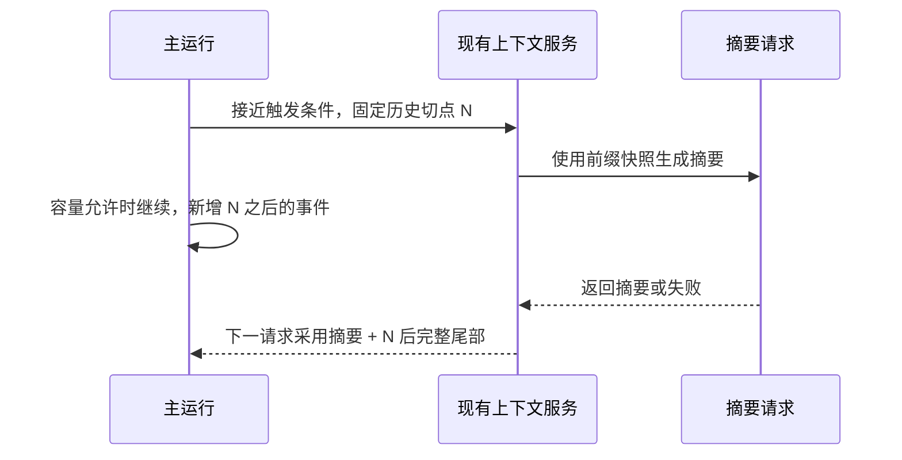

# 发布增量对当前实现的影响与接续建议

> 2026-10-19，本地 `dev` 工作区的 M5 首次交付版本。以下根据实际入口与[发布调研](README.md)提出，不是全仓审计，也不代表已实施或已复现所有候选问题。

## 1. 已有能力与本轮发现分开

| 本地事实 | 代码入口 | 本轮判断 |
| --- | --- | --- |
| Go 基地址集中配置，主对话 / 搜索适配分开 | [defaults.json](../../../src/my_agent/defaults.json)、[go.py](../../../src/my_agent/models/go.py)、[native_search.py](../../../src/my_agent/models/native_search.py) | 官方推荐地址发生变化，值得优先核对；不能据此宣布当前请求失败 |
| 自动压缩创建作业后在请求边界等待 | [context/service.py](../../../src/my_agent/context/service.py) 的 `prepare`、`_start` | 已确认与非阻塞后台压缩不同；这是现有选择，不是异步 API 没有生效 |
| 摘要按切点装配，工具结果可外置回读 | [context/window.py](../../../src/my_agent/context/window.py) | 可直接作为后台压缩基础，无需再建摘要系统 |
| 每请求刷新共享任务 / 团队材料并拼入 system 内容 | [runtime/loop.py](../../../src/my_agent/runtime/loop.py)、[spaces/context.py](../../../src/my_agent/spaces/context.py) | 动态前缀可能影响缓存；尚未测得实际损失，不先声称有性能故障 |
| 团队简报含全体成员、当前成员相关边、全部初始工作项，不含其他成员完整历史 | [spaces/context.py](../../../src/my_agent/spaces/context.py) 的 `member_context` | 已具备上下文隔离；规模变大时可再按需读取细节，不要重复“实现隔离” |
| 成员、会话、群聊执行和 Goal 关联已存在 | [spaces/team_service.py](../../../src/my_agent/spaces/team_service.py)、[collaboration/service.py](../../../src/my_agent/collaboration/service.py) | 优先检查消息到结果的用户体验；没有证据要求另建消息总线 |
| 完整历史会复用保存的 assistant 原生消息，请求客户端直接接收 messages | [sessions/store.py](../../../src/my_agent/sessions/store.py) 的 `SessionLog.context`、[go.py](../../../src/my_agent/models/go.py) | 候选核实项：切模型时是否带入不兼容原生字段；不是已证实的失败 |
| 记忆召回 / 维护 / 编辑与 MCP 连接 / 工具目录已存在 | [memory/service.py](../../../src/my_agent/memory/service.py)、[mcp_client/service.py](../../../src/my_agent/mcp_client/service.py) | 继续复用；不重新搭同类服务 |

先完成[现有进度里的明确待办](../../progress/project-status-and-roadmap-2026-10-19.md)，包括 `report_work` 不支持 `evidence` 的提示问题。新研究不能用来掩盖这些旧缺口，也不应把全部研究候选一次性变成实施承诺。

## 2. 优先核对 Go 服务，而不是扩大模型范围

### 最小工作范围

保留用户选定的 GLM / DeepSeek，核对官方当前主对话地址、模型目录和现有搜索协议；特别关注自身 UA、稳定会话身份是否覆盖主请求、压缩、记忆和辅助搜索。地址变化的依据是[官方 Go 文档](https://opencode.ai/v2/docs/console/go/)，不只是另一个客户端的修复记录。

若进入实现，只在现有模型配置和请求构建入口处理协议映射；现有保存配置如何迁移要明确，不能只改默认值后误称所有用户已切换。`AGENTS.md` 当前写明旧地址，确认需要迁移时应同步规范与接入文档，不让新代码和旧约定互相矛盾。

最小真实验证应覆盖各模型一个短流式工具回合，再定向检查辅助搜索。记录响应状态、实际 model 字段、正文 / 思考首字、工具参数完成、usage，不发送个人历史。此处只是后续验证建议，本轮没有消耗模型额度。

### 不能作出的推断

- 官方推荐新端点，不证明旧端点已关闭；旧路径可能仍是兼容入口。
- Go 续费成功，不证明两种接口及所有辅助调用已经正常。
- 官方 DeepSeek alias 更新，不证明 Go 同步切到同一 revision。
- 新模型宣称更快，不证明此前首字延迟已解决；不能只测总耗时。

独立 DeepSeek Search / Fetch 是另一个可选工具后端，不是主模型 provider 切换。若采用，继续使用现有工具结果、归档与 Trace，凭据单独解析，不增加自动 fallback 或静默重试。它是否减少模型往返，应与当前搜索路径做一个具体任务比较后决定。

## 3. 合作空间下一步：让图对应可观察的工作

### 保留三层事实

| 层次 | 表达什么 | 用户应看到什么 |
| --- | --- | --- |
| 组织关系 | 成员职责、建议协作方式 | 当前 M5 的成员图；可以编辑，不是通信白名单 |
| 工作关系 | 谁负责什么、需要哪份结果 | 工作项、范围与交接；描述不等于强制验收门槛 |
| 执行事实 | 本次消息启动了哪些 Run / Goal，当前在等什么 | 活跃状态、消息来源、产物链接、局部停止与接续 |

建议直接利用现有身份与事件建立投影，而不再保存一份独立“团队运行日志”。同一成员可能多次运行，一次群聊也可能关联多个执行；成员级“已完成”无法准确表达这些关系。

对于已有状态，先改善显示与关联；只有真实事实缺失时才加字段。候选显示包括：已排队、已接纳、正在调用模型 / 工具、等待某请求结果、当前回复结束、工作结果已提交、失败 / 已停止。不要为了显示这些状态强制模型填一套报告。

### 最值得做的一个小场景

沿用现有计数器或另一简单空白项目，由实现成员工作、Review 成员读取成果，接收者汇总。期间用户问普通问题，再停止其中一个成员。观察：

1. 回复是否回到提出问题的会话 / 工作，而非当前恰好打开的界面。
2. 等待是否显示目标和已有部分结果；不能靠不断发模型请求来模拟等待。
3. 停止范围是否局限于对应工作，已有文件和其他成员是否保留。
4. 接续时是否明确使用已完成结果，不自动重放结果未知的写操作。

这是实际体验建议，不是新增四项运行前审批。只有场景发现缺陷才修相应链路；不能从上游修过等待预算就推断本项目必然也有同样 bug。

## 4. 上下文优先处理材料装配，再处理压缩时机

### 先做可以观察到收益的减量

当前已有材料清单、服务端 usage 与估计值。用它们回答：稳定规则有多少、工具定义有多少、团队 / 工作状态每轮变化多少、召回记忆是否重复、历史工具结果是否已经缩短。没有这些观察，不应再凭感觉降低压缩点。

建议装配顺序为稳定系统规则与工具契约、当前任务必要材料、摘要及近期完整消息。具体 role / message 位置要遵守 GLM / DeepSeek 实际协议，不直接照搬其他厂商的“phantom user message”。必要项目规范保留原有约束效力；动态状态移位是缓存与结构优化，不是降低规则优先级。

MCP 已按需加载，不应重做。可以考虑把低频的管理工具也放入已有发现方式，常用文件读写、执行和当前模式必需工具保持直接可见。取舍是减少重复 token，但首次发现可能增加一轮请求；收益应包括工具成功率与延迟，不能只看 schema 字节减少。

成员上下文不需要默认为全任务所有历史。已有简报可以继续提供稳定角色目录；详细工作结果按关联身份读取。两个成员都需要相同规范并不意味着无效重复，真正要避免的是无关历史与过期状态反复进入每个人的请求。

### 后台压缩的建议形态

现有 `prepare` 在自动触发后执行 `await self.wait(sid)`，保证本次请求马上用减量结果。若用户希望长任务少停顿，可在此基础上增加后台模式：

这里的 N 必须是现有消息组允许的切点，避免拆开工具调用与结果。快照固定后不改旧事件，新事实照常追加；摘要完成只替换其覆盖前缀。用现有序号和作业身份即可，不增设内容 hash、语义评分或用户逐次确认。

关键取舍：

- **800K 仍是现有自动配置。** 不擅自退回 128K，也不把某个保留比例强加给所有会话。是否另设预备点，应根据实际窗口余量及输出预留决定。
- **后台工作有成本。** 主请求继续携带大历史，同时摘要请求占用并发；短会话或用户即将结束时可能得不偿失。
- **采用是请求边界行为。** 不修改已经发出的请求；面板区分摘要已准备、尚未采用、已采用。
- **达到实际输入容量时仍需等待或明确返回容量问题。** 后台不意味着可以发送超过窗口的请求。
- **独立维护失败与主模型失败分开。** 若要让后台压缩失败后继续使用仍可容纳的历史，应在实施方案中明确为维护作业的语义；主模型、实际执行 / 保存故障的停止规则保持不变。不能用“优化”悄悄吞掉失败。
- **取消和模型切换明确归属。** 停止摘要不等于取消整个主任务；旧模型生成的摘要可作为文本候选，但原生思考 / 续接块不能未经适配混用。

最小验证是压缩期间追加新事实后尾部没有丢失、取消不误覆盖、失败保留历史，再做短模型样本。800K 长输入未实测的限制继续保留，不把小样本改称百万 token 验收。

### 双模型切换的定向核实

目前 `SessionLog.context` 读取 `AssistantCommitted` 的 `turn.native`，模型客户端将 messages 交给服务。需检查从 GLM 切到 DeepSeek、再切回时，哪些字段是通用文本 / 工具结果，哪些只能由原模型续接。正确方向是**在请求投影处处理兼容性，保留原历史供查看**，不是清空历史或屏蔽用户切换。

这是代码入口支持的检查候选。本轮没有模型回放或完整适配审计，尚不能宣布字段一定被拒绝，也不能把 Pi 的处理方式当作所有 provider 的统一协议。

## 5. 记忆与合作：复用一份事实，区分有效范围

研究没有支持立即引入向量库、图数据库或新记忆服务。现有来源、纠错、召回入口仍有价值。进一步结合合作空间时，建议明确以下分工：

| 内容 | 优先存放 / 来源 | 带入方式 |
| --- | --- | --- |
| 用户长期偏好、项目惯例 | 现有长期记忆与项目规范 | 相关时召回，可查看与纠正 |
| 任务目标、用户确认的决定、接续摘要 | 现有任务记录 | 成员共享，下一请求刷新 |
| 某成员当前工作、等待对象、部分成果 | WorkItem、协作请求与执行事件 | 当前成员简报或按需读取 |
| 完整对话、原始工具日志 | 会话事件 / 归档 | 保留来源引用，需要细节再读 |

例如 Review 指出问题但用户尚未授权修复，应该保存为任务待办 / 结果，不自动升级为永久偏好或新的执行目标。用户纠正某个任务结论时，下一次请求应使用更正后的记录；无需让所有成员先填确认表才能继续。

若未来加入成员专属长期记忆，应先证明角色有跨任务复用价值。否则稳定 Member 身份加当前任务简报就够用，额外记忆分区只会增加纠错位置。

## 6. 工作流与资源包按需求增长

本项目已经能保存模板、角色、Skill 和工具来源。下一步可以先提供“保存为我的工作方式”：将现有配置引用组合起来，导入时预览实际来源和本机需要补的环境引用，不携带凭据、个人绝对路径、历史对话或会话身份。

可执行流程先验证一种常见模式：派发实现 → 等待结果 → 用户主动或已有范围内的独立 Review → 汇总 → 根据授权进入修复。允许跳过、返回、人工接续；普通对话结束不自动变成持续 Goal。

这不要求立刻支持任意 JavaScript、完整图调度器或所有上游 Mods 事件。若以后确实需要运行时插件，先提出无法被现有 Skill / MCP / 模板满足的例子，再确定少数扩展接口。安装、生命周期、取消和错误展示届时都要有真实入口，不能仅有一个 JSON 配置框。

CodeMode 的候选场景限定为多次只读调用后聚合结果。先比较已有工具发现加批处理是否足够。会修改文件的多步执行仍走现有工具事实和错误语义，不默认并行，不因为一段编排代码返回就认定所有嵌套操作完成。

## 7. 建议批次与不采纳内容

| 顺序 | 交付目标 | 最小观察 / 验证 | 进入下一项的条件 |
| --- | --- | --- | --- |
| 1 | 服务兼容与明确缺陷收尾 | 双模型短工具回合、目标错误提示、切换请求材料 | 已确认差异有结果；无关旧失败独立记录 |
| 2 | 合作工作可追踪可接续 | 一个现有团队场景中的等待、停止、汇总 | 用户能看懂实际状态，发现的问题定向修复 |
| 3 | 请求材料精简 | 同一小任务的材料构成、usage、首字与工具成功 | 证明没有只省 schema 却增加更多往返 |
| 4 | 可选后台压缩 | 固定切点 + 新增尾部、取消与失败、短模型样本 | 语义和成本清楚，保留原 800K 策略选择 |
| 5 | 可复用工作方式 | 一个资源组合导入并执行一次 | 有复用需求后再扩展执行关系 / 插件接口 |

以上不是新阶段验收表，也不设固定工期；确定实施时应重新选范围。安装交付仍按原规划独立推进。

本轮不建议照搬的内容：厂商固定缓存时长；默认多 Agent；自动换模型；自动重试及重放副作用；按天数自动删除历史；强制 Git / worktree；任何报告完整性或评分门槛；为接入几个扩展先建设通用插件平台。某些上游采用这些默认值，只能说明它们的产品取舍，不能覆盖本项目已经确认的行为。
